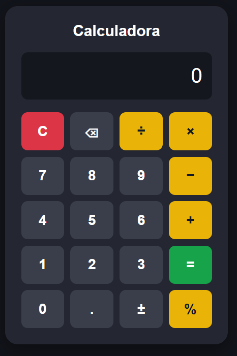

# 🧮 Calculadora com JavaScript

Aplicação web de uma calculadora desenvolvida com HTML5,
CSS3 e JavaScript puro (Vanilla JavaScript).

O projeto foi criado para praticar conceitos fundamentais
de desenvolvimento front-end, incluindo manipulação do DOM,
eventos, funções e lógica de programação.

## 📸 Demonstração

## 🚀 Funcionalidades

- Operações de adição, subtração, multiplicação e divisão
- Cálculos com números decimais
- Conversão simples de porcentagem
- Inversão de sinal positivo e negativo
- Limpeza do visor
- Exclusão do último dígito durante a digitação
- Tratamento de divisão por zero
- Suporte ao teclado do computador
- Interface responsiva para desktop e dispositivos móveis

## 🛠️ Tecnologias utilizadas

- HTML5 — Estrutura da aplicação
- CSS3 — Estilização e responsividade
- JavaScript — Lógica e interatividade
- Visual Studio Code — Ambiente de desenvolvimento

## 📂 Estrutura do projeto

01-calculadora/
├── index.html
├── style.css
├── script.js
├── README.md
└── imagens/
    └── calculadora.png

## 💻 Como executar

1. Faça o download do projeto ou clone o repositório.
2. Abra a pasta 01-calculadora.
3. Execute o arquivo index.html em seu navegador.

Não é necessário instalar bibliotecas ou dependências.

## ⌨️ Atalhos do teclado

| Tecla | Função |
|-------|--------|
| 0 a 9 | Digitar números |
| + | Adição |
| - | Subtração |
| * | Multiplicação |
| / | Divisão |
| Enter ou = | Calcular |
| Backspace | Apagar último dígito |
| Escape | Limpar |
| . ou , | Decimal |
| % | Porcentagem |

## 🧠 Conceitos praticados

- Estruturação de páginas com HTML semântico
- Estilização utilizando CSS Flexbox e Grid
- Criação de layouts responsivos
- Manipulação do DOM com JavaScript
- Eventos de clique e teclado
- Funções, variáveis e condicionais
- Operações matemáticas e tratamento de erros

## 📈 Possíveis melhorias futuras

- Histórico de cálculos
- Alternância entre tema claro e escuro
- Suporte a operações matemáticas avançadas
- Aprimoramento da acessibilidade
- Testes automatizados

## 👨‍💻 Autor

Guilherme Nascimento

Projeto desenvolvido para estudo e prática
de desenvolvimento web.
